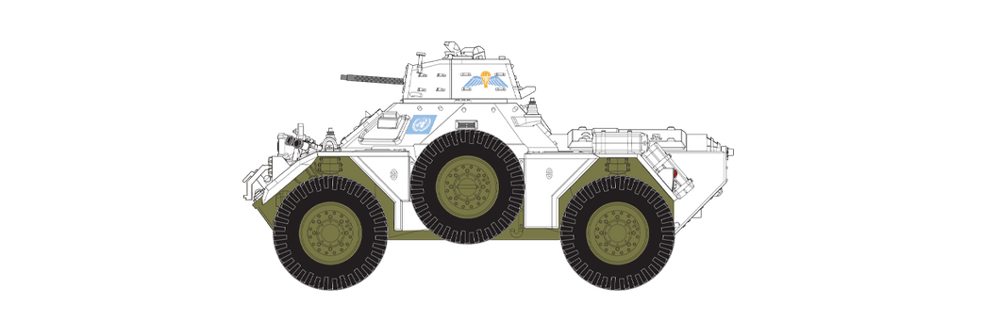
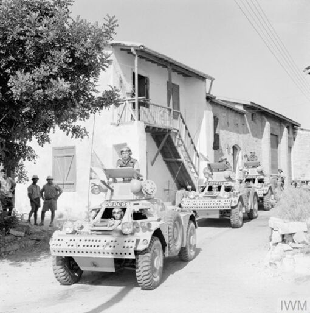
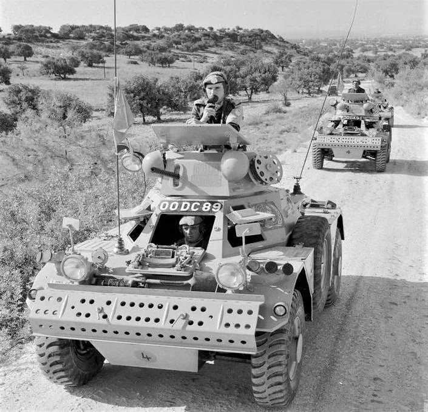
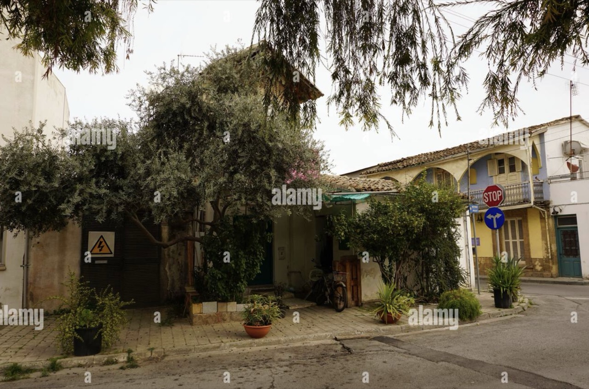

# #181 Ferret Scout Car Mk.2

5th Parachute Brigade, UN Peacekeeping Force in Cyprus, 1974. A 1:35 diorama build based on the Ferret Scout Car Mk.2 from Airfix A1379, with figures from MiniArt and AK Interactive.

## Notes

After a successful series of light armoured reconnaissance and liaison vehicles, the Ferret Scout Car saw widespread British and Commonwealth military service from the 1950s onwards, with later variants of the Ferret taking part in the Gulf War of 1990.

A vehicle type which can trace its lineage back to the successful Daimler Dingo scout car of the Second World War, the Ferret was designed with stealth in mind, a light and fast armoured vehicle which could probe enemy positions, reporting any discovered weak points back to commanders, with their own forces moving to exploit what they found.

Weighing in at around 4 tons operational weight, the Ferret was of all welded construction and featured armour protection capable of withstanding most small arms fire, but nothing much heavier, although it was not intended that the vehicle would be operating in direct opposition to heavy enemy armour.

If it did find itself in a bit of trouble, the 4 wheel drive Ferret was powered by a reliable 6 cylinder Rolls Royce engine which gave it a top speed of 45 mph, a speed it could also achieve in reverse if required, something which could prove extremely useful if the crew found themselves in a tight spot.

### The Kit

[Ferret Scout Car Mk.2 Airfix No. A1379 1:35](https://www.scalemates.com/kits/airfix-a1379-ferret-scout-car-mk2--1460185) is the first boxing of the 2023 tooling from Airfix. It comes with 3 schemes:

* Scheme A: Ferret Scout Car Mk.2, West Germany, August 1961.
* Scheme B: Ferret Scout Car Mk.2, British Army Training Unit Suffield (BATUS), Canadian Forces Base Suffield, Alberta, Canada, 1980's.
* Scheme C: Ferret Scout Car Mk.2, 5th Parachute Brigade, British Army Overseas, Cyprus, 1974.

### Paint Scheme

Selected Scheme C: Ferret Scout Car Mk.2, 5th Parachute Brigade, British Army Overseas, Cyprus, 1974.

| Feature               | Color                | Recommended | Paint Used                  |
|-----------------------|----------------------|-------------|-----------------------------|
| lights                | Silver - Metallic    | No 11       | H8                          |
| lights                | Orange - Gloss       | No 18       | H92                         |
| lights                | Red - Gloss          | No 19       | H90                         |
|                       | Dark Earth - Matt    | No 29       |                             |
|                       | Black - Matt         | No 33       | H12                         |
| upper hull            | White - Matt         | No 34       | H11                         |
| upper hull undercoat  | Aircraft Grey        |             | H57                         |
|                       | Gunmetal - Metallic  | No 53       |                             |
| interior              | Aluminium - Metallic | No 56       | XF16                        |
| seats                 | Black - Satin        | No 85       | H12                         |
| ammo box              | Brown - Matt         | No 186      | H37                         |
| lower hull, radio     | Bronze Green - Matt  | No 75       | H330                        |
| interior primer       |                      |             | aqueous black surfacer 1000 |

### Diorama Planning

I found this photograph of the British Army in Cyprus in the 1960s in the
[IWM collection](https://www.iwm.org.uk/collections/item/object/205191377),
and have used that as inspiration for the diorama.

### Basic Ferret Build

The Ferret slams together very nicely..

### Figures

I've adapted some figures from the following sets:

* [British Jeep Crew Special Edition MiniArt 35469 1:35](https://www.scalemates.com/kits/miniart-35469-jeep-crew--1669932)
    * driver and commander
    * uniform adaptations with Tamiya epoxy putty
* [Children Set 1: Boys AK Interactive AK35016 1:35](https://www.scalemates.com/kits/ak-interactive-ak35016-children-set-1-boys--1446159)
    * one of the boys as an "onlooker" - removed the Mickey Mouse that he was holding

My painting is a bit rough, but practicing the "Painting Skin Tones made easy by Calvin Tan" techniques. I shouldn't have primed black-based/zenithal highlights - just made my job harder.

The boy's looking pretty mischievous at this point, but I do like how Im getting the darker skin tone.

### Building Design

Initial planning...

I designed the main building structures in Affinity Designer 2 - see
[buildings.afdesign](./buildings/buildings.afdesign).

I wanted to capture a rural village street in compact presentation with a degree of forced perspective.

I prepared the parts in
[buildings.xs](./buildings/buildings.xs)
for cutting from 3mm MDF on my Library's [xTool S1 Laser Cutter](https://leap.tardate.com/equipment/nlb/xtools1/).

Assembling the buildings...

### The Tree

I've going for an elderly Olive tree look, as seen lining streets, rather than planted for Olive production.

The basic technique I've used:

* Wrapped Wire #24, #28, #30 for the main trunk and branches
* Electrical wire stripped and wound for minor trigs and branch extremes and twigs
* trunk bulked up with mod podge layers mixed with fine flocking
* leaves from foam flocking and fine leaves

I forget to photograph all the stages...

### Getting Ready for Final Assembly

Some scenic details sculpted from modeller's clay.

Scenic elements combined ready for staging the figures and vehicle

### Completing the Ferret

### Label

I designed a label in Affinity Designer 2: [label.afdesign](./label/label.afdesign).

### Final Gallery - UN Peacekeeping Paras in the Village, Cyprus 1974

## Credits and References

* [this project on scalemates](https://www.scalemates.com/profiles/mate.php?id=74137&p=projects&project=167703)
* Ferret Scout Car Mk.2 Airfix No. A1379 1:35
    * [on scalemates](https://www.scalemates.com/kits/airfix-a1379-ferret-scout-car-mk2--1460185)
    * [on airfix.com](https://uk.airfix.com/products/ferret-scout-car-mk2-a1379)
    * [instructions](./assets/A1379-instructions.pdf)
    * Purchased from Airfix for £19.99 (Jan-2024).
* British Jeep Crew Special Edition MiniArt 35469 1:35
    * [on scalemates](https://www.scalemates.com/kits/miniart-35469-jeep-crew--1669932)
    * Purchased from Miniature Hobby for SG$17.90 (Oct-2026).
* Children Set 1: Boys AK Interactive AK35016 1:35
    * [on scalemates](https://www.scalemates.com/kits/ak-interactive-ak35016-children-set-1-boys--1446159)
    * Purchased from M Workshop for SG$26.00 (May-2024).

### Research References

* <https://en.wikipedia.org/wiki/Cyprus>
* <https://en.wikipedia.org/wiki/United_Nations_Peacekeeping_Force_in_Cyprus>
* <https://peacekeeping.un.org/en/factsheet/unficyp>
* <https://unficyp.unmissions.org/en/events-summer-1974>
* <https://studyofcanada.ca/cyprus-1974-a-peacekeeping-crash-course-by-frank-reid/>

#### Cyprus. 1974. Ferret Mk 2 scout cars of the British Army's 5th Royal Inniskilling Dragoon Guards on UN peacekeeping duty. (705 x 678)

[IWM](https://www.iwm.org.uk/collections/item/object/205194940)

#### THE BRITISH ARMY IN CYPRUS IN THE 1960S

[IWM](https://www.iwm.org.uk/collections/item/object/205191377)

#### Tank Chats #113 | Ferret Scout Car | The Tank Museum

YouTube by The Tank Museum

### Nicosia (Lefkosia), Cyprus

Olive trees in the streets..

[](https://www.alamy.com/nicosia-lefkosia-cyprus-the-worlds-last-divided-capital-a-quaint-street-corner-the-street-is-lined-with-buildings-in-shades-of-white-yellow-and-beige-with-some-showing-signs-of-age-and-weathering-a-small-light-colored-building-with-a-green-door-and-a-sign-that-reads-stop-is-situated-on-one-side-of-the-street-a-large-olive-tree-stands-prominently-in-the-foreground-its-branches-reaching-out-over-the-street-a-small-light-colored-building-with-a-dark-brown-door-is-also-visible-on-the-same-side-of-the-street-a-stop-sign-is-visible-on-the-opposite-side-of-the-street-the-street-image684347489.html)

### Build References

#### Airfix | Ferret Scout Car Mk.2 (1:35) - Designer Video

YouTube by Airfix

