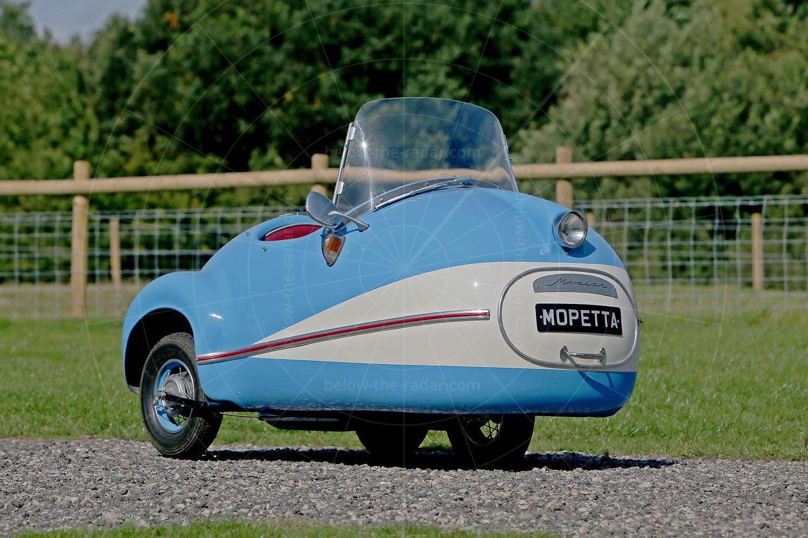

# #xxx Brütsch Mopetta 1956

Building the Brütsch Mopetta 1956 1:24 resin kit from ZoomOn, finished with a chap enjoying a drive in the country.

## Notes

The Brütsch Mopetta is an egg-shaped, single-seat, three-wheel automobile manufactured from 1956 to 1958 with a total production of 14. It was the smallest in a series of microcars designed by Egon Brütsch.

### The Kit

Brütsch Mopetta 1956 ZoomOn Z088 1:24

### Paint Scheme

| Feature               | Color                | Paint Used |
|-----------------------|----------------------|------------|
| seat                  |                      | H37        |
| interior              |                      | H67        |
| main body             |                      | H23        |
| dashboard, tyres      |                      | H12        |
| chassis               |                      | H18        |
| motor, axle           |                      | MC213      |
| chrome parts          |                      | SM206      |

### Build Log

And now for something completely different: the Brütsch Mopetta!

Going to have fun with this for our local 48 hr group build for Oct-2026.

I reserved as much time as I could for polishing the body to try and get as high gloss as possible.

### The Figure

I used some polymer clay from Daiso to sculpt and Aardman-style figure. This material is not very easy to use for small figure sculpting, unless you have time to dry the figure in parts. I did my best in the limited time available

### The Base

I made a simple base with HD foam

### Gallery 1

At the end of the 48 hour group build:

### Final Gallery

I realise I left off the "reversing handle". Some new shots for the final gallery:

## Credits and References

* [this project on scalemates](https://www.scalemates.com/profiles/mate.php?id=74137&p=projects&project=249692)
* Brütsch Mopetta 1956 ZoomOn Z088 1:24
    * [on scalemates](https://www.scalemates.com/kits/zoomon-z088-bruetsch-mopetta-1956--1343721)
    * [on ZoomOn site](https://www.zoomonmodel.com/product-page/z088-brutsch-mopetta1956)
    * [instructions](./assets/Z088-instructions.jpg)
    * Purchased from Kits for Kids 2026 for SG$15 (Sep-2026).

### Research References

* <https://en.wikipedia.org/wiki/Br%C3%BCtsch_Mopetta>
* <https://www.below-the-radar.com/brutsch-mopetta/>
* <http://www.microcarmuseum.com/tour/mopetta.html>

#### The story of the bizarre Brutsch Mopetta microcar

YouTube by Below the Radar Cars

