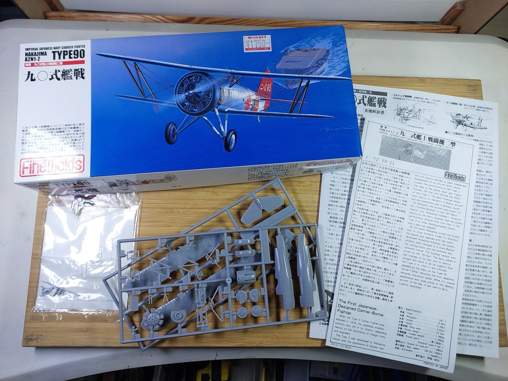
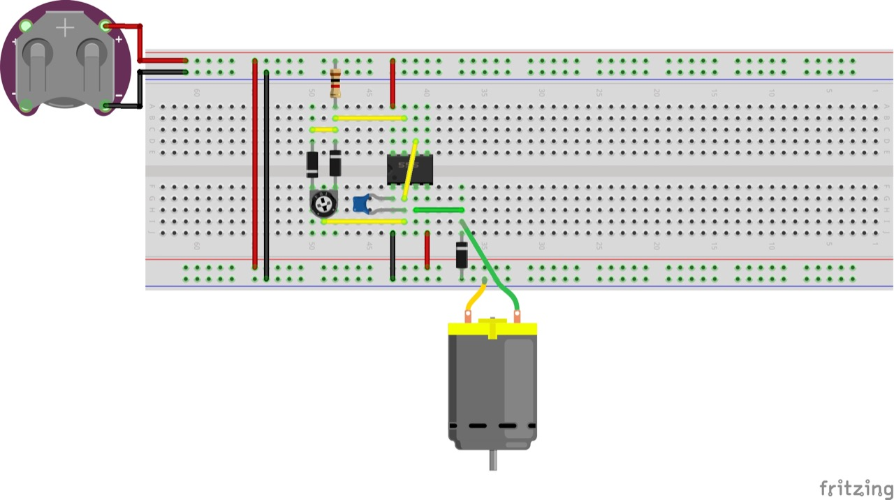
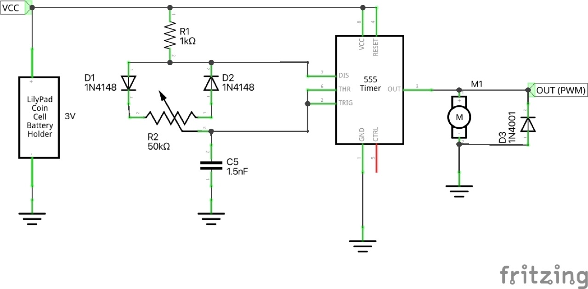
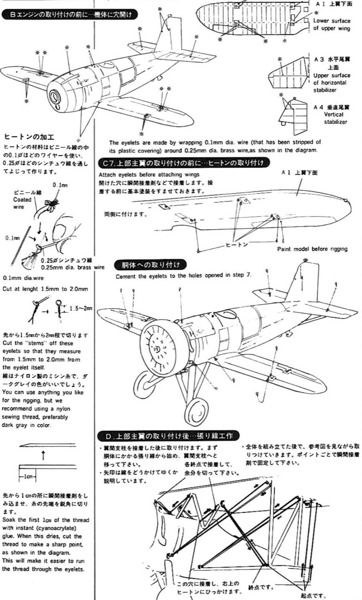

# #xxx Nakajima A2N1-2

Building and motorizing the Nakajima A2N1-2 from Fine Molds in 1:72. It was the first Japanese-designed carrier-borne fighter.

Here's a quick demo..

## Notes

The Nakajima A2N was the first Japanese-designed carrier-borne fighter. It was a single-engined biplane of mixed construction, with a fixed tailwheel undercarriage. It was officially adopted by the Navy as the Type 90 Carrier Fighter in 1932.

### The Kit

[Imperial Japanese Navy Carrier Fighter Nakajima A2N1-2 Type 90 Fine Molds No. FP21 1:72](https://www.scalemates.com/kits/fine-molds-fp21-nakajima-a2n1-2-type-90--225895)
is the 2001 re-boxing of the old 1990 tool. Still a decent quality mold, with details parts in white metal.

The kit includes two schemes:

* A: I空母加賀戦闘機隊 佐藤仁志一空兵乗機 昭和11年3月（報国45号機 Aircraft flown by First Class Seaman Hitoshi Sato, Fighter Squadron of the Aircraft Carrier *Kaga* – March 1936 (Hōkoku Aircraft No. 45)
* B: 1報国12 横須賀号 Hōkoku 12: Yokosuka-gō

### Paint Scheme

I'm building scheme A.

| Feature                             | Color                | Recommended | Paint Used |
|-------------------------------------|----------------------|-------------|------------|
| engine cowling                      | Black                | C2/H2       | H2         |
| tail areas (scheme a)               | Red                  | C3/H3       | H3         |
| fuselage, prop front                | Silver               | C8/H8       | H8         |
|                                     | Metallic Steel       | C28/H18     |            |
| spars, interior fittings            | Matt Black           | C33/H12     | H12        |
| prop rear                           | Red Brown            |             | H47        |
| interior (alt)                      | Tan                  | C44/H27     |            |
| left nav light                      | Clear Red            | C47/H90     | H90        |
| right nav light                     | Clear Blue           | C50/H93     | H93        |
| interior, seat                      | Metallic Blue Green  | C57/H63     | H63        |
| exhaust pipes                       | Metallic Burnt Iron  | C61/H76     | H76        |
| tires                               | Tire Black           | C137/H77    | RCM001     |
|                                     |                      |             |            |

### Construction

Ready to go! I'm building this as part of a local 48hr group build.

First evening - basically finished my parts prep, measured up the motor fitting. Ready for a productive day tomorrow.

### Motor Installation

### Motor Control

I'm using a simple variable PWM motor controller based on a 555 timer.
It works fine with a 3V coin cell to drive the particular motor I am using.

PWM gives a much more realistic, slower speed drive than just direct drive from a coin cell.

The motor needs to be wired in reverse (red - ground, black - positive) in order to spin correctly (clockwise) for the propeller.

Circuit designed with Fritzing, see [A2N1-2.fzz](./A2N1-2.fzz).

Testing the motor again before I start painting.

### Motor Control Board

I transferred the electronics to a small SO-16 DIP adapter with mainly surface-mount components

### Closing Up the Fuselage

### Rigging

The instructions have some detailed rigging guides, including the fabrication of turnbuckles from brass wire:

I knitted a brace of eyelets for anchoring the rigging..

### Decals and Final Assembly

### Build Complete for the 48hour Build

The pilot is from
[Japanese Navy Airmen Set Hasegawa No. X72-16 1:72](https://www.scalemates.com/kits/hasegawa-x72-16-japanese-navy-airmen-set--1123725).

### The Background

### Final Gallery

I mounted the plane and took some final glamour shots..

## Credits and References

* [this project on scalemates](https://www.scalemates.com/profiles/mate.php?id=74137&p=projects&project=159079)
* Imperial Japanese Navy Carrier Fighter Nakajima A2N1-2 Type 90 Fine Molds No. FP21 1:72
    * [on scalemates](https://www.scalemates.com/kits/fine-molds-fp21-nakajima-a2n1-2-type-90--225895)
    * [instructions](./assets/FP21-instructions.pdf)
    * Purchased from Yodobashi Akihabara for ¥1,750 (Sep-2023).
* Japanese Navy Airmen Set Hasegawa No. X72-16 1:72
    * [on scalemates](https://www.scalemates.com/kits/hasegawa-x72-16-japanese-navy-airmen-set--1123725)

### Research References

* <https://en.wikipedia.org/wiki/Nakajima_A2N>

#### Before the Zero: The Nakajima A2N Carrier Fighter

YouTube by Not A Pound For Air To Ground

### Build References

#### Fine Molds Imperial Japanese Carrier Fighter Nakajima A2N1-2 Type 90 1/72 Scale Model Aircraft

YouTube by FatBoy's Scale Model Shop

