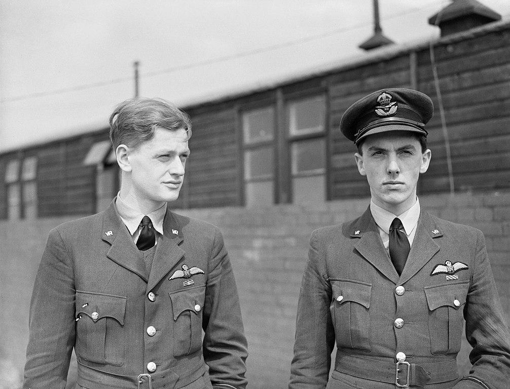
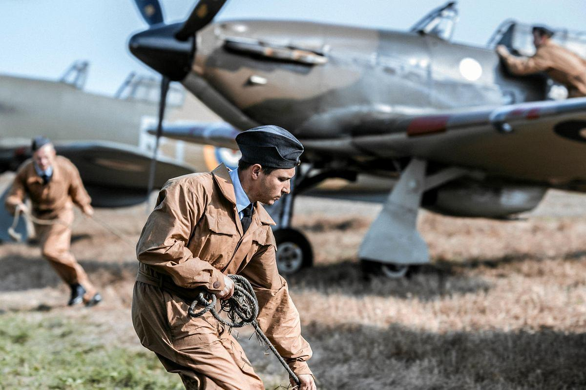
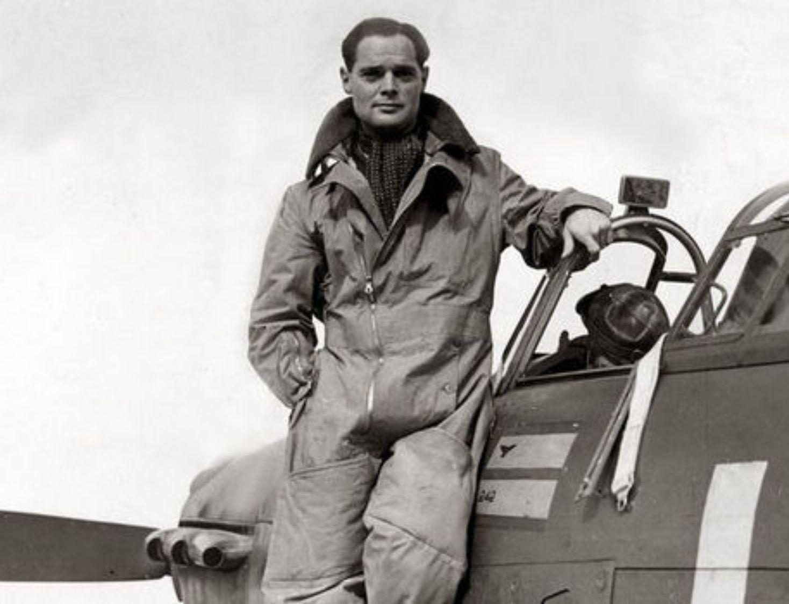
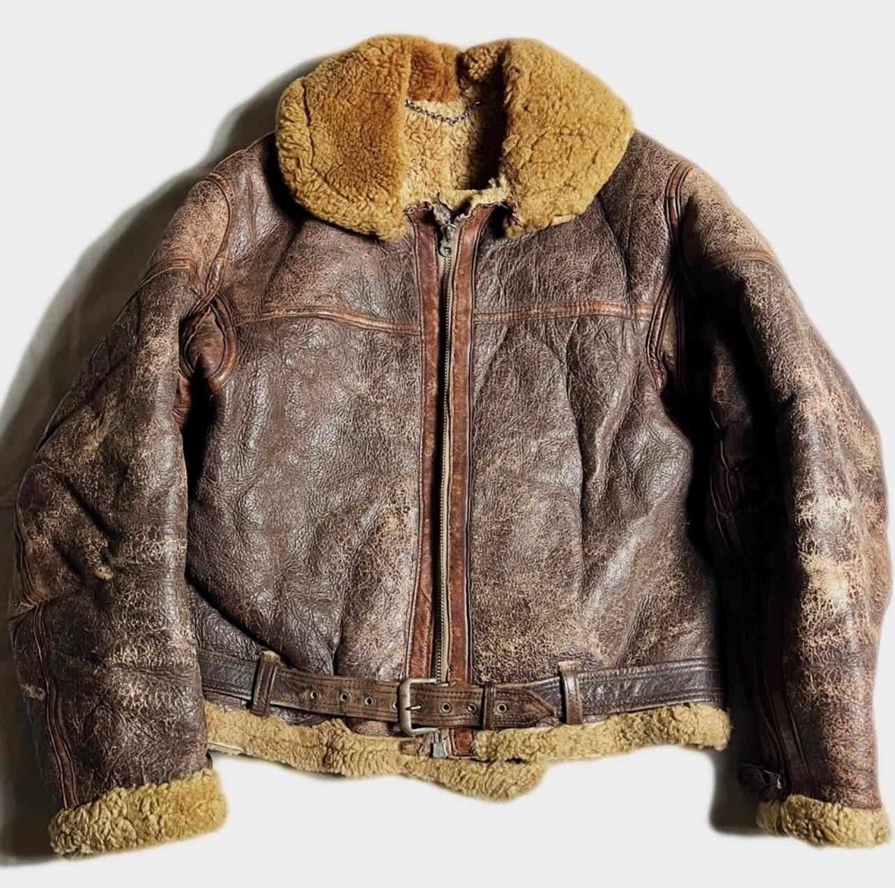

# #176 RAF Pilots and Ground Personnel

Painting up the set of figures from ICM in 1:48 scale.

## Notes

I've used these figures in a few projects:

* [#135 Homecoming](../Homecoming/)

### The Kit

RAF Pilots and Ground Personnel (1939-1945) ICM No. 48081 1:48 has appeared in various forms and was tooled back in the 1990's.
I got it included as part of the diorama set WWII RAF Airfield ICM No. DS4802 1:48 from 2021.

### Paint Scheme

| Feature               | Color                | Recommended | VMC Equivalent                          | Used                                        |
|-----------------------|----------------------|-------------|-----------------------------------------|---------------------------------------------|
| A shoes & boots       | Semigloss Black      | MM1597      | 70.861 Gloss Black                      |                                             |
| B                     | Flat Black           | MM1749      | 70.950 Black                            |                                             |
| C                     | Flat White           | MM1768      | 70.951 White                            |                                             |
| C parachute straps    | Flat White           | MM1768      | 70.993 White Grey                       |                                             |
| D                     | Intermediate Blue    | MM1720      | 70.943 Grey Blue                        |                                             |
| D uniform             | Intermediate Blue    | MM1720      | 70.943 Grey Blue                        | see recipes below                           |
| E                     | Semigloss Blue       | MM1594      | 70.963 Mediterranean Blue               |                                             |
| F                     | Flat Sea Blue        | MM1718      | 70.898 Dark Sea Blue                    |                                             |
| G                     | Military Brown       | MM1701      | 70.843 Cork Brown                       |                                             |
| G flight suit         | Military Brown       | MM1701      | 70.843 Cork Brown                       | see recipes below                           |
| G briefcase           | Military Brown       | MM1701      | 70.843 Cork Brown                       |                                             |
| G jacket              | Military Brown       | MM1701      | 70.843 Cork Brown                       | 70.872 Chocolate Brown, 70.981 Orange Brown |
| H mae west            | Chromate             | MM1584      | 70.953 Flat Yellow + 70.942 Light Green | 70.953 Flat Yellow                          |
| I parachute pack      | Sand                 | MM1706      | 70.986 Deck Tan                         |                                             |
| J                     | Medium Gray          | MM1721      | 70.905 Bluegrey Pale                    |                                             |
| K                     | Light Ghost Gray     | MM1728      | 70.990 Light Grey                       |                                             |
| L                     | Dark Green           | MM1710      | 70.893 US Dark Green                    |                                             |
| M                     | Radome Tan           | MM1709      | 70.917 Beige                            |                                             |
| M inner fleece        | Radome Tan           | MM1709      | 70.917 Beige                            | 70.976 Buff                                 |
| N                     | Skin Tone            | MM1516      | 70.955 Flat Flesh                       |                                             |
| O                     | Wood                 | MM1735      | 70.843 Cork Brown                       |                                             |
| P                     | Pale Green           | MM1716      | 70.974 Green Sky                        |                                             |
| P satchel             | Pale Green           | MM1716      | 70.974 Green Sky                        | 70.885 Pastel Green + 70.897 Bronce Green   |
| Q                     | Aluminum             | MM1781      | 70.997 Silver                           |                                             |
| R                     | Steel                | MM1780      | 70.864 Natural Steel                    |                                             |
| S                     | Gunmetal             | MM1795      | 70.863 Gunmetal Grey                    |                                             |
| T                     | Bright Brass         | MM1782      | 70.801 Brass                            |                                             |
| U jerry cans          | Field Green          | MM1712      | 70.850 Medium Olive                     |                                             |
| V                     | Leather              | MM1736      | 70.984 Flat Brown                       |                                             |

#### RAF blue-grey service uniform

| Stage     | VMC Recipe                                                     | AK Recipe         |
|-----------|----------------------------------------------------------------|-------------------|
| Base      | 70.816 or 70.907 Pale Grey Blue + 70.870 Medium Sea Grey (1:2) | AK11865           |
| Shadows   | 70.867 or 70.862 Black Grey + 70.899 Dark Prussian Blue (2:1)  | AK11190           |
| Mid-tone  | 70.907 Pale Grey Blue                                          | AK11866           |
| Highlight | 70.907 + 70.951 White (5:1)                                    | AK11866 + AK11868 |

#### RAF khaki drill

| Stage           | VMC Recipe                              |
|-----------------|-----------------------------------------|
| Base            | 70.879 Green Brown + 70.917 Beige (2:1) |
| Shadows         | 70.889 Olive Brown                      |
| Mid-tone        | 70.917 Beige                            |
| Highlight       | 70.976 Buff                             |
| Final highlight | 70.976 + 70.951 White (4:1)             |

#### Olive flying suit

| Stage           | VMC Recipe                 |
|-----------------|----------------------------|
| Base            | 70.887 US Olive Drab       |
| Shadows         | 70.895 Gunship Green       |
| Mid-tone        | 70.889 Olive Brown         |
| Highlight       | 70.879 Green Brown         |
| Final highlight | 70.976 Buff + 70.879 (1:3) |

#### Brown leather flying jacket

| Stage                | VMC Recipe                                      |
|----------------------|-------------------------------------------------|
| Base                 | 70.846 Mahogany Brown + 70.843 Cork Brown (3:1) |
| Shadows              | 70.822 Camouflage Black Brown                   |
| Mid-tone             | 70.846 Mahogany Brown                           |
| Highlight            | 70.843 Cork Brown                               |
| Final edge highlight | 70.843 + 70.917 Beige (3:1)                     |

### Step Ladder

| Feature               | Color                | Recommended | Paint Used |
|-----------------------|----------------------|-------------|------------|
| O base                | Wood                 | MM1735      | H37        |

### Workbench

| Feature               | Color                | Recommended | Paint Used |
|-----------------------|----------------------|-------------|------------|
| O base                | Wood                 | MM1735      | H37        |
| Q top                 | Aluminum             | MM1781      | H76        |

### Jerry Cans

| Feature               | Color                | Recommended | Paint Used |
|-----------------------|----------------------|-------------|------------|
| U base                | Field Green          | MM1712      | H337       |

### Gallery

## Credits and References

* RAF Pilots and Ground Personnel (1939-1945) ICM No. 48081 1:48
    * [on scalemates](https://www.scalemates.com/kits/icm-48081-raf-pilots-and-ground-personnel--211639)
    * [on icm.com.ua](https://icm.com.ua/figure/raf-pilots-and-ground-personnel-1939-1945/)
    * [instructions](./assets/48081-Instructions.pdf)
    * Purchased as part of DS4802
* WWII RAF Airfield ICM No. DS4802 1:48
    * [on scalemates](https://www.scalemates.com/kits/icm-ds4802-wwii-raf-airfield--1346442)
    * [on icm.com.ua](https://icm.com.ua/pack/wwii-raf-airfield-spitfire-mk-ix-spitfire-mk-vii-raf-pilots-and-ground-personnel/)
    * Purchased from IBG Models for €25.00 (Jun-2021).

### Research References

#### Remembering the RAF Ground Crew : The Unsung Heroes

YouTube by The Battle of Britain With Dilip Sarkar MBE

### Build References

* <https://www.everythingairbrush.com/wp-content/uploads/2014/03/Vallejo-Equivalent-Colors-1.pdf>

#### ICM 1/48 RAF Pilots and Ground Personnel - "Full Build + Final Reveal" (9.11.19)

YouTube by International British Modeler

