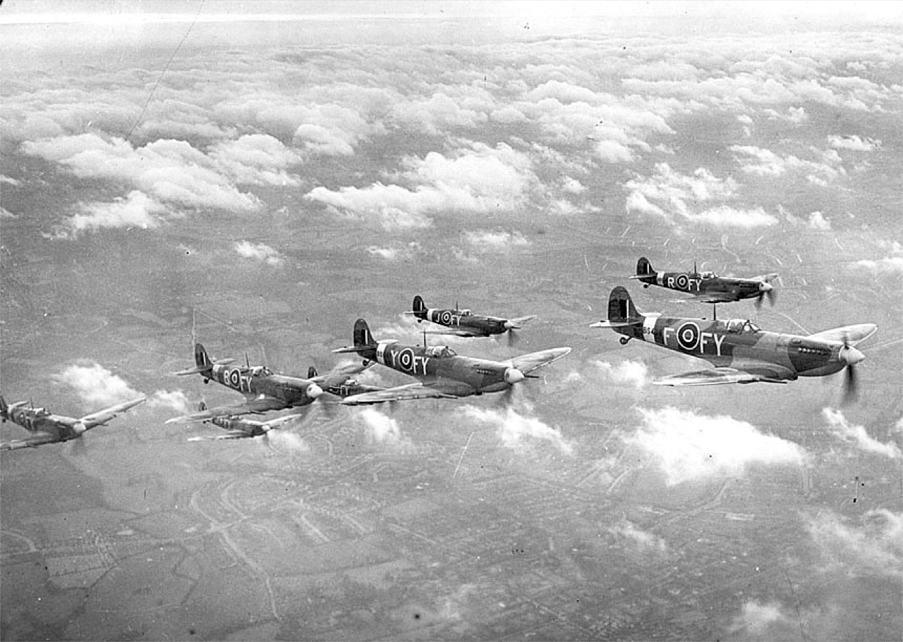
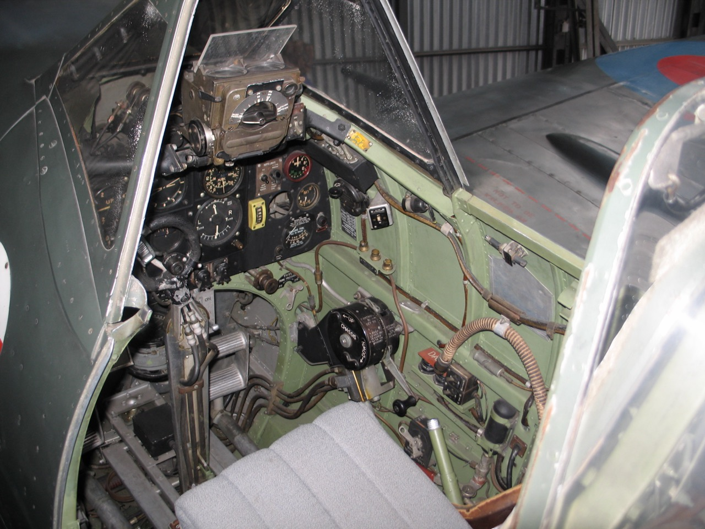
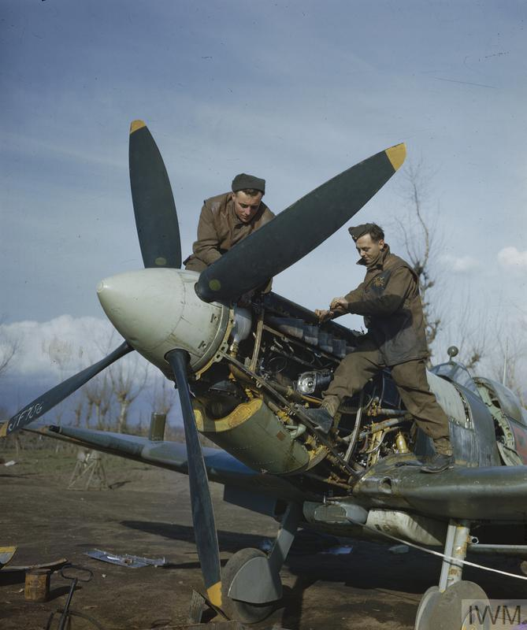

# #xxx Spitfire Mk.IX

Spitfire Mk.IX JE-J as flown by Wing Commander Johnnie Johnson. The ICM 1:48 kit build was largely completed during a 48-hour group build, but finished on a diorama base over a couple of weeks.

## Notes

The [Supermarine Spitfire Mk.IX](https://en.wikipedia.org/wiki/Supermarine_Spitfire_(late_Merlin-powered_variants)#Mk_IX_(type_361)) was a variant developed as a quick fix to counter the German Focke-Wulf Fw 190.

The Air Ministry made the decision that Mk Vc airframes should be converted to take the more powerful engine and, as a result, many of the early Mk IXs were converted Mk Vcs which did not have any of the refinements which later appeared. These could be identified by the Type C wing with the large double blisters over the inner cannon bays and the identification light on the fuselage spine, behind the aerial mast. The elevator horns were also smaller in size than that of most Mk IXs which had larger horn balances.

#/media/File:SpitIX611b.jpg)

### The Kit

[Spitfire Mk.IX ICM No. 48061 1:48](https://www.scalemates.com/kits/icm-48061-spitfire-mkix--140999), purchased as part of DS4802,
is a re-boxing of a 2001 tooling.

The kit includes two schemes:

* Royal Canadian Air Force - Aviation royale canadienne (1924-1968):
    * 144 Wing MK392/JE-J · Cdr. J. Johnson, 1944
* Royal Air Force (1918-now):
    * No. 611 Sqn. BS435 FY-F H. Armstrong, 1942 · Biggin Hill / London

#### "JE-J" (Serial MK392)

The "JE-J" markings represent the personal initials of Wing Commander [James Edgar "Johnnie" Johnson](https://www.google.com/search?q=james+edgar+%22johnnie%22+johnson&kgmid=/m/032s77). As a Wing Leader, he was granted the rare privilege of bypassing standard squadron codes to use his own initials. Johnson used these markings on two highly successful Spitfire Mk.IX airframes:

* Spitfire Mk.IXb (Serial No. EN398): Johnson took command of the Kenley Wing in March 1943 and claimed 12 aerial victories plus 5 shared victories in this exact plane. It is widely considered one of the most successful individual combat Spitfires in history.
* Spitfire LF Mk.IXe (Serial No. MK392): Johnson later flew this low-altitude optimized variant while commanding No. 144 (Canadian) Wing during and after the D-Day invasions. Adorned with distinct black-and-white "invasion stripes," he scored another 12 victories in this airframe, including his final kill of the war.
    * The armament configuration of Wing Commander Johnnie Johnson's Spitfire Mk.IX (Serial MK392) is a famous topic of discussion among aviation historians because it was uniquely modified.
    * MK392 was originally built at the factory with a standard "C" type "Universal" wing configuration. However, in June 1944, Johnson had a Maintenance Unit (MU) modify the aircraft in the field to match the newer "E" type layout layout—but with a twist. Its configuration consisted of:
        * Two 20mm Hispano Cannons: The cannons were swapped from their original inner wing positions to the outer cannon bays, mounted upside down (inverted). This shift reduced structural strain on the wings while carrying 250 lb fighter-bomber bombs.
        * Four .303 Browning Machine Guns Removed: The four small-caliber outer .303 machine guns were completely removed to save weight and aerodynamic drag, as Johnson considered rifle-caliber rounds ineffective for modern combat and strafing.
        * No Heavy Machine Guns: While the factory-built "E" wing layout paired the moved cannons with two heavy .50 caliber Browning machine guns, MK392 did not carry .50 caliber guns. This was due to supply shortages of the new heavy machine guns in the summer of 1944.
    * Ultimately, MK392 went into combat over Normandy armed exclusively with two 20mm Hispano cannons and zero machine guns, capitalizing entirely on the hitting power of his cannon shells.

#### "FY-F" (Serial BS435)

The "FY-F" marking belonged to an early-production Spitfire F Mk.IX (Serial No. BS435). The "FY" code identified No. 611 (West Lancashire) Squadron, which operated out of the famous RAF Biggin Hill sector.

* This aircraft was the personal mount of Squadron Leader Hugo "Squeak" Armstrong, a highly respected Australian flying ace who served as the squadron’s Commanding Officer.
* Delivered in late 1942, this aircraft was part of the very first wave of Mk.IX models deployed to aggressively counter the German Fw 190 over northern France. Tragically, on February 5, 1943, Armstrong and BS435 were intercepted and shot down by German fighters north-northwest of Boulogne, France, resulting in Armstrong's death.
* The early-production Spitfire F Mk.IX, Serial BS435 (marked "FY-F"), carried the standard factory-delivered "C" type "Universal" wing configuration. Its armament configuration consisted of:
    * Two 20mm Hispano Mk II Cannons: One mounted in the inner cannon bay of each wing. Unlike the later custom "E" modifications, these cannons were in their standard inboard positions and were belt-fed, carrying 120 rounds per gun.
    * Four .303 Browning Machine Guns: Mounted in pairs in the outer sections of each wing, outboard of the cannons. These fast-firing machine guns carried 350 rounds per gun.
    * Two Unused Outer Cannon Bays: The "Universal" C-wing featured twin cannon structural bays in each wing. In this configuration, the outer cannon bays were empty, plugged with the characteristic short, stubby aerodynamic fairings (often mistaken by casual observers for extra gun barrels).
* This standard "two cannon, four machine gun" layout allowed pilots like Squadron Leader Hugo Armstrong to use the high-capacity .303 machine guns to range and sight their targets before unleashing the devastating, heavier hitting power of the 20mm cannons.

### Selected Build Scheme: "JE-J" (Serial MK392)

Paint selection:

| Feature                | Color                | Recommended | Paint Used |
|------------------------|----------------------|-------------|------------|
| A invasion stripes     |  Matt White          | MM1768      | H11        |
| B invasion stripes     |  Flat Black          | MM1749      | H12        |
| B engine block         |  Flat Black          | MM1749      | H12        |
| C upper camo 2         |  RAF Dark Green      | MM2060      | H73        |
| D upper camo 1         |  RAF Ocean Grey      | MM2057      | H337       |
| E lower camo           |  RAF Medium Sea Grey | MM2058      | H75        |
| F spinner              |  RAF Sky "Type S"    | MM2049      | H74        |
| F fuselage band        |  RAF Sky "Type S"    | MM2049      | H74        |
| G prop tips            |  Insignia Yellow     | MM1708      | RCM004     |
| G leading edge trim    |  Insignia Yellow     | MM1708      | H24        |
| H interior             |  European Green      | MM1764      | H62        |
| L exhaust              |  Rust                | MM1785      | H76 + H14  |
| M                      |  Gunmetal            | MM1795      | H18        |
| M intakes              |  Gunmetal            | MM1795      | RCM011     |
| P (unused)             |  Insignia Red        | MM1705      | H327       |
| R (unused)             |  Leather             | MM1736      | H66 + H47  |
| S tanks, details       |  Aluminium           | MM1781      | XF16       |
| T undercarriage detail |  Steel               | MM1780      | RCM011     |
| U (unused)             |  Field Green         | MM1712      | H340       |
| V props                |  semigloss Black     | MM1597      | H2 + H12   |

Where there are options in the build, the instructions are not very clear (or completely silent)
as to which are correct for a specific airframe.
Based on some research, guesswork, and other sleuthing, here are the choices I made where required:

* tailplanes: D3,D4 (not D1,D2)
* wingtips: E9,E10 (not E7,E8)
* rear view mirror: E18 (not E17)
* upper engine cowling: removed (E15 unused)
* side engine cowlings: removed/cut-away completely (E13,E14 unused)
* lower engine cowling and air intake: D7,D8 partially cut-away and used with D9 (not D10,D11,D12)
* wing armament covers: D14,D15 (not D16,D17)
* canon switched position to outer bay (B27/B29 change place)
* no internal armament details added (B30,B31,B32,B33,B35,E19 unused)
* no stores/loadout (build steps 11,13,13 unused)

### Build Log

Cockpit and engine builds require by far most of the construction effort:

Cockpit interior completed with a very simple process of shading over black, then picking out a few details with dry brush and AK markers

Very happy with how the engine is looking. I haven't added any extra details: it's purely out of the box at this stage.

Test fit. Hmm, those wing roots really need attention...

Quick application of Vallejo Acrylic Putty:

Finally starting to lay down paint on the body..

Close but no cigar! This is as far as I got at the end of the 48 hours.
Due to a bunch of other commitments, I think I only put about 10 hours on the build.

#### After the 48hr Group Build is Over

But I'm not giving up! While finishing a 48hr build is nice, it can also just be a jump start for a better build.

Decals down...
I didn't do a clear coat first, and ended up regretting that.
The decals took quite some time and encouragement with Mr Mark Softer to settle down and eliminate silvering over some of the matt finishes.

### Final Assembly

### Diorama Base

I used [MakerCase](https://en.makercase.com/) to generate a simple parametric design for the base:

* material thickness: 3mm
* inside dimensions:
    * width: 240 mm
    * height: 20 mm
    * depth: 200 mm
* closed box
* edge joints: flat
* panel labels: enabled (to be excluded from cutting)
* cut line width: 0.25 mm
* cut compensation: none
* panel layout: separate, single file
* exported as [box-template.svg](./case/box-template.svg)
* refined in Affinity Designer as [box.afdesign](./case/box.afdesign)
* exported for cutting as [box.svg](./case/box.svg)
* finalised in xTool Studio as [box.xs](./case/box.xs)

I cut the box with an [xTool S1 Laser Cutter at the library](https://leap.tardate.com/equipment/nlb/xtools1/).

### Weathering

### Diorama Construction

## Credits and References

* [this project on scalemates](https://www.scalemates.com/profiles/mate.php?id=74137&p=projects&project=249222)
* Spitfire Mk.IX ICM No. 48061 1:48
    * [on scalemates](https://www.scalemates.com/kits/icm-48061-spitfire-mkix--140999)
    * [on icm.com.ua](https://icm.com.ua/aviation/spitfire-mk-ix/)
    * [instructions](./assets/48061-Instructions.pdf)
    * Purchased as part of DS4802
* WWII RAF Airfield ICM No. DS4802 1:48
    * [on scalemates](https://www.scalemates.com/kits/icm-ds4802-wwii-raf-airfield--1346442)
    * [on icm.com.ua](https://icm.com.ua/pack/wwii-raf-airfield-spitfire-mk-ix-spitfire-mk-vii-raf-pilots-and-ground-personnel/)
    * Purchased from IBG Models for €25.00 (Jun-2021).

### Research References

* <https://en.wikipedia.org/wiki/Supermarine_Spitfire_(late_Merlin-powered_variants)#Mk_IX_(type_361)>
* <https://forum.largescaleplanes.com/index.php?/topic/98207-johnnie-johnson-spitfire-mkix-mk392/>
* <https://imodeler.com/2014/10/johnnie-johnsons-mk392/>
* <https://troopsoftime.com/product/raf-02-supermarine-spitfire-mk-ixe-mk392-w-commander-j-e-johnson-no-144-wing-march-1944/>
* <https://www.spitfires.com/blog/the-story-of-spitfire-armament-modifications-and-wing-designs/>

* <https://community.hornbyhobbies.com/forums/topic/40038-spitfire-mkix/>
* <https://www.team-bhp.com/forum/shifting-gears/178609-scale-models-aircraft-battle-tanks-ships-56.html>
* <https://www.iwm.org.uk/history/second-world-war/battle-of-britain/why-did-spitfires-change-their-guns>

#### Why did Spitfires change their guns? (Ft. Jonathan Ferguson)

YouTube by Imperial War Museums

#### SUPERMARINE SPITFIRES OF THE ROYAL AIR FORCE IN ITALY, JANUARY 1944

Aircraftman Jim Birkett and Leading Aircraftman Wally Passmore working on the Merlin engine of a Supermarine Spitfire of No 241 Squadron in Southern Italy, January 1944.

### Build References

* <https://www.facebook.com/share/p/1KCk7NiHTV/>

#### ICM Spitfire Mk. XVI || 1/48 || S/Ldr Otto Smik || Step by step || Full video build

YouTube by ModCom

#### Building the engine bay from the 1/48 ICM Spitfire Mk.IX

YouTube by SteamGeezer and Son Independent Traders

#### Building the ICM 1/48 Spitfire Mk.IXc "Beer Delivery"

YouTube by SteamGeezer and Son Independent Traders

