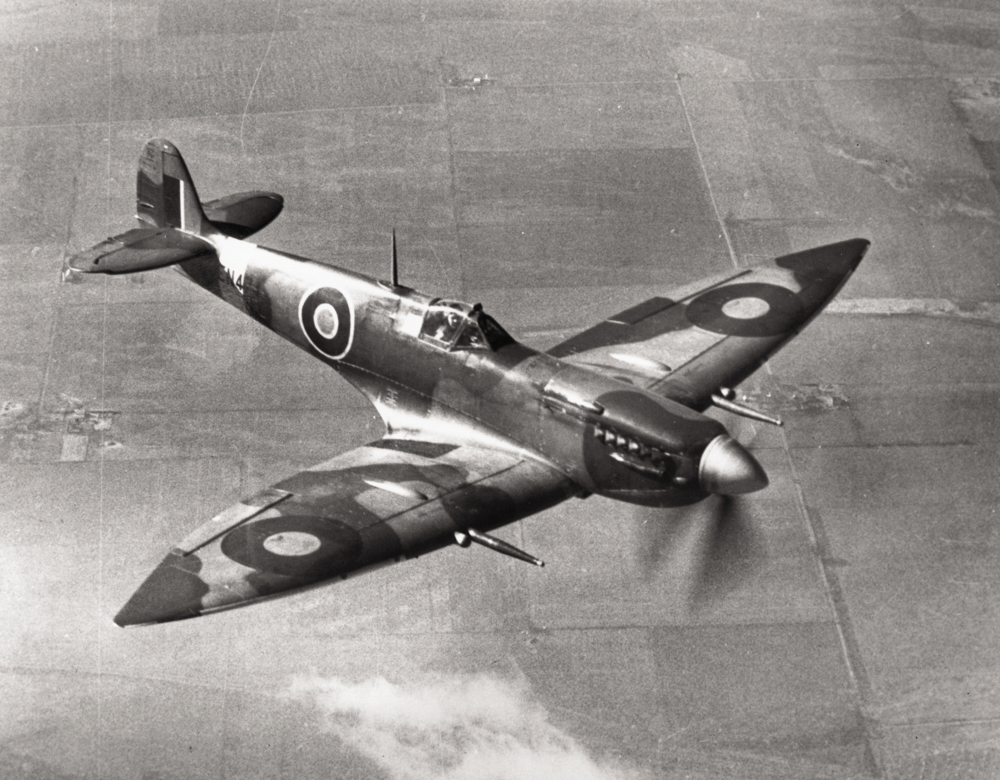

# #178 Spitfire Mk.VII

Spitfire Mk.VII NX-O (Spirit of Kent) as flown by Squadron Leader James O'Meara. This is the ICM 1:48 re-boxing of a 2001 tooling.

## Notes

The [Spitfire Mk.VII](https://en.wikipedia.org/wiki/Supermarine_Spitfire_(late_Merlin-powered_variants)#Mk_VII_(type_351)) was a high altitude pressurised variant, powered by the Merlin 64 or 71 series engine with two-stage, two-speed superchargers.

Extended, "pointed" wingtips were fitted to the Type C wings, increasing the wingspan to 40 ft 2 in (12.2 m). Because the threat from high altitude bombers never materialised many Mk VIIs later reverted to the normal, rounded wingtip.

### The Kit

[Spitfire Mk.VII ICM No. 48062 1:48](https://www.scalemates.com/kits/icm-48062-spitfire-mk-vii--1316778),
purchased as part of [DS4802](https://www.scalemates.com/kits/icm-ds4802-wwii-raf-airfield--1346442),
is a re-boxing of a 2001 tooling.

The kit includes two schemes:

* Royal Air Force (1918-now):
    * No. 124 Sqn. ON-W, Flg Off. W Hibbert, Bradwell bay, June 1944
    * No. 131 Sqn. MD120, NX-O Spirit of Kent, Sqn Ldr James O'Meara, Colerne March 1944

#### "NX-O" (Serial MD120) – "Spirit of Kent"

This aircraft was flown by the notable RAF ace James O'Meara. Because No. 131 Squadron was named the "County of Kent" squadron, his specific airframe proudly bore the white painted name "Spirit of Kent". Its camouflage scheme lacked the standard dark green patterning, opting for a lighter grey and blue blend better suited to hiding in the thin haze of extreme altitudes

#### "ON-W" (Serial MD139) – D-Day Top Cover

Flown by Walter Hibbert, this aircraft participated directly in Operation Overlord (D-Day) on June 6, 1944. Operating with No. 124 Squadron, its primary mission was providing high-altitude fighter cover over the invasion fleets to prevent German high-altitude reconnaissance aircraft from monitoring Allied troop movements. To ensure it wasn't shot down by friendly forces, the high-altitude scheme was overlaid with stark, hand-painted invasion stripes.

### Selected Build Scheme: "NX-O" (Serial MD120) – "Spirit of Kent"

Paint selection:

| Feature                                | Color                | Recommended | Paint Used     |
|----------------------------------------|----------------------|-------------|----------------|
| A                                      | Flat White           | MM1768      | H11            |
| B cockpit fittings                     | Flat Black           | MM1749      | H12            |
| B engine block                         | Flat Black           | MM1749      | H12            |
| C upper fuselage & spinner             | Medium Gray          | MM1721      | H337           |
| C upper fuselage & spinner - highlight | Medium Gray          | MM1721      | H337 + H51     |
| C upper fuselage & spinner - shade     | Medium Gray          | MM1721      | H337 + H32     |
| C engine fittings                      | Medium Gray          | MM1721      | H11            |
| D lower fuselage                       | Flat Light Blue      | MM1562      | H25+H104       |
| D lower fuselage - highlight           | Flat Light Blue      | MM1562      | H45+H25+H104   |
| D lower fuselage - shade               | Flat Light Blue      | MM1562      | H25+H54+H104   |
| E prop tips                            | Insignia Yellow      | MM1708      | RCM004         |
| F cockpit interior                     | European Green       | MM1764      | H62            |
| G exhaust pipes                        | Rust                 | MM1785      | H76 (H47+H14?) |
| H cannon                               | Gun Metal            | MM1795      | H18?           |
| J                                      | Aluminium            | MM1781      | H8             |
| J rocker cover                         | Aluminium            | MM1781      | H11            |
| K pedals, intake grills                | Steel                | MM1780      | RCM011         |
| L gun port covers                      | Military Brown       | MM1701      | H84            |
| M                                      | Intermediate Blue    | MM1720      | H56            |
| N props                                | Semigloss Black      | MM1597      | H2 + H12       |

Where there are options in the build, the instructions are not very clear (or completely silent)
as to which are correct for a specific airframe.
Based on some research, guesswork, and other sleuthing, here are the choices I made where required:

* tail wheel: B38 (not B38+B38)
* rear view mirror: E18 (not E17)
* canopy: F2 closed (not F3, F5)
* inspection panels: integrated (E13,E14 unused)
* no internal armament details added (B34,B35 unused)

### Build Log

I built up the entire engine before realising that it doesn't fit inside the fuselage,
so I ended up throwing most of it away in the final assembly.

## Credits and References

* [this project on scalemates](https://www.scalemates.com/profiles/mate.php?id=74137&p=projects&project=249221)
* Spitfire Mk.VII ICM No. 48062 1:48
    * [on scalemates](https://www.scalemates.com/kits/icm-48062-spitfire-mk-vii--1316778)
    * [on icm.com.ua](https://icm.com.ua/aviation/spitfire-mk-vii/)
    * [instructions](./assets/48062-Instructions.pdf)
    * Purchased as part of DS4802
* WWII RAF Airfield ICM No. DS4802 1:48
    * [on scalemates](https://www.scalemates.com/kits/icm-ds4802-wwii-raf-airfield--1346442)
    * [on icm.com.ua](https://icm.com.ua/pack/wwii-raf-airfield-spitfire-mk-ix-spitfire-mk-vii-raf-pilots-and-ground-personnel/)
    * Purchased from IBG Models for €25.00 (Jun-2021)
    * Used for the following projects:
        * [#135 Homecoming](../../RAF/Homecoming/)
        * [#176 RAF Pilots and Ground Personnel](../../RAF/raf-pilots-and-ground-personnel/)
        * [#177 Spitfire Mk.IX](../../Spitfire/IX/)
        * [#178 Spitfire Mk.VII](../../Spitfire/VII/)

### Research References

* <https://en.wikipedia.org/wiki/Supermarine_Spitfire_(late_Merlin-powered_variants)#Mk_VII_(type_351)>

#### Spitfires in the Stratosphere ! | Spitfire Mk.VI & Mk.VII

YouTube by The Antique Airshow

#### Spitfire Mk1 to Mk24 | How Spitfires kept getting better

YouTube by Imperial War Museums

### Build References

* <https://hyperscale.com/features/2002/spitfireviicbs_1.htm>
